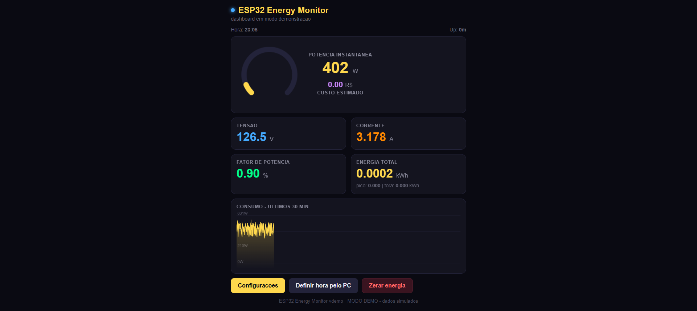

# ⚡ ESP32 Energy Monitor

[](https://github.com/mpsc/esp32-energy-monitor/actions/workflows/build.yml)
[](LICENSE)

Monitor de consumo de energia em tempo real com **ESP32**, clamp CT **SCT-013** e módulo **ZMPT101B**. Mostra potência, tensão, corrente, fator de potencia, energia acumulada (kWh) e **custo em R$ com tarifa horaria** — tudo em um dashboard web embutido (portal cativo) e no **Home Assistant via MQTT com auto-discovery**.

> 🎮 **Sem hardware?** [Abra o dashboard em modo demo](https://mpsc.github.io/esp32-energy-monitor/dashboard/index.html?demo=1) — dados simulados direto no navegador (GitHub Pages).



## ✨ Funcionalidades

- **Medicao real de potencia** (W): RMS de tensao/corrente + potencia ativa `mean(v×i)` a ~4kHz, nao e "estimativa" por fator de potencia
- **Tarifa horaria**: precos diferentes para hora pico/fora-pico (suporta virada de meia-noite), custo estimado em R$ atualizado em tempo real
- **Dashboard web embutido** no PROGMEM: grafico de 30 min, gauge, KPIs — atualizado via WebSocket a cada 2s
- **Portal cativo**: conecte no Wi-Fi `Energia-Monitor` e a pagina abre sozinha (captive portal de verdade, funciona em Android/iOS)
- **Configuracao pela web**: Wi-Fi, MQTT, tarifa, calibracao e hora — tudo na pagina, persistido na NVS (sobrevive reboot)
- **MQTT + Home Assistant**: 8 sensores via auto-discovery (`homeassistant/sensor/.../config`), disponibilidade com LWT, topico JSON agregado para Node-RED
- **Energia acumulada persistente**: kWh salvos na flash a cada 60s (nao zera ao reiniciar)
- **Medicao no core 0** (FreeRTOS task): web server nunca trava, mesmo com a janela de amostragem de 1s
- **Modo demo** para desenvolvimento da UI sem hardware

## 🧩 Pecas

| Peca | Observacao | Ref. aprox. |
|---|---|---|
| ESP32 DevKit | qualquer modulo com ESP32-WROOM | R$ 25-40 |
| Clamp CT SCT-013-030 | 30A, **saida ja em 1V** (sem burden externo) | R$ 15-25 |
| Modulo ZMPT101B | senso de tensao com isolamento | R$ 8-15 |
| Resistores 10k, 10k, 100k + 10uF | divisor de meio-tensao pro SCT | R$ 1 |
| Fonte 5V + protetor/fusivel | ver **seguranca** em [docs/WIRING.md](docs/WIRING.md) | - |

> Existe tambem o SCT-013-000 (100A:50mA) — exige burden e cuidados extras. Veja [docs/WIRING.md](docs/WIRING.md).

## 🚀 Inicio rapido

```bash
git clone https://github.com/mpsc/esp32-energy-monitor.git
cd REPO
pio run                 # compila (ou: python -m platformio run)
pio run -t upload       # grava via USB
pio device monitor      # 115200 bauds
```

Depois:
1. Conecte no Wi-Fi **`Energia-Monitor`** (senha `12345678`)
2. A pagina abre automaticamente (portal cativo) — ou acesse `http://192.168.4.1/`
3. Em **Configuracoes**: informe o Wi-Fi da sua rede (para STA + NTP) e/ou o broker **MQTT**
4. Reinicie e acesse por `http://energia.local` (mDNS) ou pelo IP mostrado no monitor serial

Edite os pinos/padroes em [`include/config.h`](include/config.h) se seu hardware diferir.

### 📗 Usando o Arduino IDE (alternativa)

O repo inclui um espelho do firmware como sketch do Arduino IDE em [`arduino/ESP32_Energy_Monitor/`](arduino/ESP32_Energy_Monitor/):

1. Instale o pacote de placas **ESP32 by Espressif** (Gerenciador de Placas)
2. Bibliotecas via Library Manager: **ArduinoJson** (Benoit Blanchon, v7) e **PubSubClient** (Nick O'Leary, v2.8)
3. Bibliotecas por ZIP (fora do Library Manager):
   - [AsyncTCP.zip](https://github.com/me-no-dev/AsyncTCP/archive/refs/heads/master.zip)
   - [ESPAsyncWebServer.zip](https://github.com/me-no-dev/ESPAsyncWebServer/archive/refs/heads/master.zip)
4. Abra `ESP32_Energy_Monitor.ino`, selecione a placa **ESP32 Dev Module** e envie

> ⚠️ A fonte de verdade e o projeto PlatformIO (e o que o CI compila). Apos mexer no firmware, copie as mudancas de `src/` e `include/` para `arduino/` (o `web_page.h` ja e sincronizado automaticamente pelo `tools/gen_web_page.py`).

## 📐 Como funciona a medicao

```
ZMPT101B ──> GPIO34 (ADC1) ─┐
                             ├──> janela de 1s a ~4kHz ──> RMS + pot. real
SCT-013-030 ──> GPIO35 (ADC1)┘        (offset removido pela media da
                                        propria janela: 1s = 60 ciclos
                                        exatos em 60Hz)
```

- `analogReadMilliVolts()` usa a calibracao de fabrica do ESP32 (eFuse) — sem multimetro pra achar Vref
- 1 janela/segundo, potencia real `P = mean(v×i)×calV×calI`, fator de potencia `PF = P/(V×I)`
- Energia: `Wh += P×Δt/3600` por janela, dividida entre pico/fora-pico pela hora local

## 🕐 Tarifa e hora

A tarifa usa a **hora local** (fuso configuravel, padrao `America/Sao_Paulo`):
- **Sem internet**: use o botao **"Definir hora pelo PC"** na pagina (envia epoch via `/api/time`)
- **Com STA conectado**: NTP automatico (`pool.ntp.org` / `a.ntp.br`)
- Sem hora valida, tudo e contado como "fora do pico" (e a pagina avisa ⚠)

## 🏠 Home Assistant (MQTT)

Com o broker preenchido na pagina web, o ESP32 conecta e publica **auto-discovery** — os sensores aparecem sozinhos no HA. Detalhes, lista completa de topicos e configuracao do painel de Energia: **[docs/HOME_ASSISTANT.md](docs/HOME_ASSISTANT.md)**.

Resumo dos topicos (base `energia`):

| Topico | Conteudo |
|---|---|
| `energia/availability` | `online` / `offline` (LWT, retido) |
| `energia/state` | JSON: `{"p":..,"v":..,"i":..,"pf":..,"kt":..,"kp":..,"ko":..,"cost":..}` |
| `energia/power` `voltage` `current` `power_factor` | valores individuais (W, V, A, %) |
| `energia/energy` `energy_peak` `energy_off` | kWh (`total_increasing` — funciona no painel de Energia do HA) |
| `energia/cost` | custo estimado acumulado (R$) |

## 📁 Estrutura

```
├── src/
│   ├── main.cpp        # Wi-Fi AP+STA, portal cativo, HTTP/WS, config
│   ├── energy.cpp/.h   # task de amostragem, RMS, potencia, tarifa, NVS
│   └── mqtt_ha.cpp/.h  # MQTT + auto-discovery do Home Assistant
├── arduino/ESP32_Energy_Monitor/  # espelho como sketch do Arduino IDE (.ino)
├── dashboard/index.html  # fonte do dashboard (editavel, tem modo demo)
├── include/
│   ├── config.h          # pinos e padroes
│   └── web_page.h        # GERADO a partir do dashboard (nao editar)
├── tools/gen_web_page.py # regenera o web_page.h (nos 2 locais)
└── docs/                 # fiação, calibracao, Home Assistant
```

Apos editar `dashboard/index.html`, regenere o firmware:

```bash
python tools/gen_web_page.py && pio run
```

## 🔌 Seguranca

⚠️ **Voce esta lidando com a rede eletrica (127/220V)!** Antes de ligar, leia [docs/WIRING.md](docs/WIRING.md) — em particular: clamp CT **nunca** pode ser aberto com a linha energizada, e o ZMPT101B deve ser alimentado por fonte isolada.

## 🗺️ Roadmap

- [ ] OTA (ArduinoOTA)
- [ ] Fase 2/3 (multiplas fases com um clamp por fase)
- [ ] Exportacao CSV do historico
- [ ] MQTT sobre TLS

## 📄 Licenca

[MIT](LICENSE) — contribuicoes sao bem-vindas!
